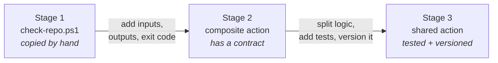

# From PowerShell script to shared GitHub Action

> A complete, runnable demo repository for the session:
> *"In many automations and deployment flows, scripts are used for
> configuration and deployments..."*

This repository tells one story in three stages: a plain PowerShell script
that got copied around an organisation, turned step by step into a versioned
GitHub Action that other teams can depend on.

Everything here runs. The tests pass, the workflows work, and the action
checks itself.

---

## The problem

Somewhere in your organisation there is a script called something like
`check-repo.ps1`. It exists in eleven repositories. No two copies are
identical. Nobody can tell you which one is correct, because *correct* was
never written down anywhere.

The script is not the problem. The **distribution model** is.

---

## The three stages



| | Stage 1 | Stage 2 | Stage 3 |
| --- | :---: | :---: | :---: |
| Runs | ✅ | ✅ | ✅ |
| Configurable | ❌ | ✅ | ✅ |
| Fails the build | ❌ | ✅ | ✅ |
| Structured output | ❌ | ❌ | ✅ |
| Unit tested | ❌ | ❌ | ✅ |
| Safe input handling | ❌ | ❌ | ✅ |
| Versioned | ❌ | ❌ | ✅ |
| Shareable | copy/paste | `@main` | `@v1` |

### Stage 1 — a script in a repository
📁 [`stages/01-script/`](stages/01-script/README.md)

Hard-coded values, `Write-Host` output, no exit code, no version. It works,
and it is already drifting.

### Stage 2 — the same script as a composite action
📁 [`stages/02-composite/`](stages/02-composite/README.md)

Inputs, outputs, a real exit code and `action.yml` as the contract. A big
improvement — and still untestable, unversioned and pinned to `@main`.

### Stage 3 — the shared action
📁 This repository root.

Logic separated from plumbing, 33 tests, cross-platform CI, job summaries,
safe input handling and a release process that moves `v1`.

### Seeing all three side by side

Run the **Demo — the three stages** workflow
([`demo-stages.yml`](.github/workflows/demo-stages.yml)) and pick `bad` as the
repository. It runs all three stages against the same sample repository and
writes the comparison to the job summary:

| Stage | Exit code | Pipeline | What the caller gets |
| --- | :---: | :---: | --- |
| Stage 1 | `0` | ✅ green | nothing machine-readable |
| Stage 2 | `1` | ❌ red | `checks-failed=2` — a count, not the reasons |
| Stage 3 | `1` | ❌ red | every failing check, named, as JSON |

Same repository. Stage 1 kept the pipeline green.

Without a runner, the same demo runs on your laptop:

```powershell
./scripts/Invoke-StageDemo.ps1              # against sample-repos/bad
./scripts/Invoke-StageDemo.ps1 -Sample good # all three stages pass
./scripts/Invoke-StageDemo.ps1 -Stage 2     # one stage at a time
```

---

## Usage

```yaml
- uses: actions/checkout@v4

- name: Check repository standards
  uses: your-org/repo-standards-action@v1
  with:
    required-files: |
      README.md
      LICENSE
      .github/CODEOWNERS
    required-readme-sections: |
      Usage
      Support
    forbidden-patterns: |
      *.pfx
      *.pem
```

Report without failing, which is how you roll a new rule out to an
organisation without breaking everyone on day one:

```yaml
- uses: your-org/repo-standards-action@v1
  with:
    required-files: SECURITY.md
    fail-on-error: 'false'
```

More examples: [`examples/`](examples/) — including an org-wide reusable
workflow that wraps this action.

---

## Inputs

| Name | Default | Description |
| --- | --- | --- |
| `path` | `.` | Repository path to check, relative to the workspace. |
| `required-files` | `README.md`, `LICENSE`, `.gitignore` | Files that must exist. One per line, or comma-separated. |
| `required-readme-sections` | _empty_ | Headings that must exist in `README.md`. Case-insensitive, any heading level. |
| `forbidden-patterns` | _empty_ | File patterns that must **not** exist, for example `*.pfx`. |
| `fail-on-error` | `'true'` | Fail the step when a check fails. |
| `job-summary` | `'true'` | Write a Markdown report to the job summary. |
| `report-path` | _empty_ | Write the full result as JSON to this path. |

Blank lines and `#` comments in list inputs are ignored.

---

## Outputs

| Name | Example | Description |
| --- | --- | --- |
| `result` | `failed` | Overall result: `passed` or `failed`. |
| `checks-total` | `5` | Number of checks that ran. |
| `checks-passed` | `3` | Number that passed. |
| `checks-failed` | `2` | Number that failed. |
| `report-json` | `{...}` | Full structured result. |
| `report-path` | `report.json` | Path to the JSON report, when requested. |

Outputs are set even when the action fails — which is exactly when you need
them.

---

## Versioning

```yaml
uses: your-org/repo-standards-action@v1        # latest compatible (recommended)
uses: your-org/repo-standards-action@v1.2.0    # exact, never moves
uses: your-org/repo-standards-action@a1b2c3d   # SHA-pinned
```

`v1` and `v1.2` are moving tags, repointed by
[`release.yml`](.github/workflows/release.yml) after the test suite passes.

The rule that matters: **if the same inputs produce a different result, it is
a breaking change** — even when it feels like a bug fix.

Full detail, including how to ship a breaking change without an outage:
📄 [`docs/versioning.md`](docs/versioning.md)

---

## Running it locally

```powershell
# Run the checks against this repository
./scripts/Invoke-RepoStandardsCheck.ps1 -Path . -RequiredFile "README.md`nLICENSE"

# Run the full test suite
Invoke-Pester -Path ./tests -Output Detailed

# See it pass, then see it fail
./scripts/Invoke-RepoStandardsCheck.ps1 -Path sample-repos/good -RequiredFile "README.md,LICENSE"
./scripts/Invoke-RepoStandardsCheck.ps1 -Path sample-repos/bad  -RequiredFile "README.md,LICENSE"

# Walk all three stages over the same repository
./scripts/Invoke-StageDemo.ps1
```

Requires PowerShell 7+ and Pester 5+.

---

## How this repository is laid out

```
action.yml                    The contract consumers depend on
scripts/                      Entry point: inputs, outputs, exit code
scripts/Invoke-StageDemo.ps1  Walks all three stages, offline
src/RepoStandards/            Pure logic, no GitHub knowledge
tests/                        Unit tests + action contract tests
stages/01-script/             Where we start
stages/02-composite/          The intermediate step
sample-repos/good|bad         Fixtures that pass and fail on purpose
examples/                     What consumers write
docs/                         The three design topics
.github/workflows/            CI, action tests, release, stage demo
```

The split between `src/` and `scripts/` is the single change that makes
everything else possible — see
📄 [`docs/testing.md`](docs/testing.md).

---

## Documentation

| | |
| --- | --- |
| 📄 [Designing inputs and outputs](docs/inputs-and-outputs.md) | Why everything is a string, safe input handling, what to output |
| 📄 [Testing](docs/testing.md) | Unit vs contract vs workflow tests, and a real bug this caught |
| 📄 [Versioning](docs/versioning.md) | Moving tags, what counts as breaking, deprecating safely |
| 📄 [Session runbook](docs/session-runbook.md) | A timed walkthrough for presenting this |

---

## Support

Open an issue in this repository.

## License

[MIT](LICENSE)
